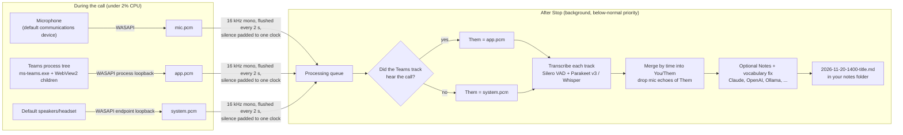
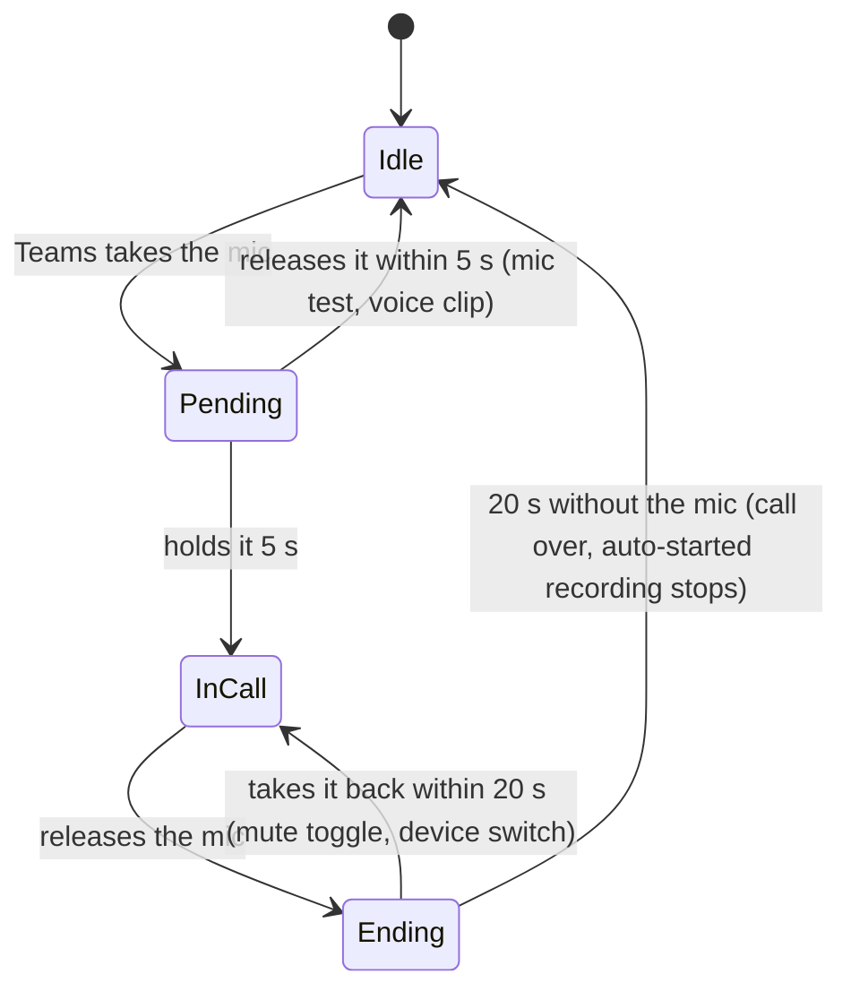

# OatsWin

A Windows port of [OpenOats](https://github.com/yazinsai/OpenOats) (MIT), built around Microsoft Teams. It records your Teams calls from the PC's own audio: no bot joins the meeting, no Teams admin permission, no Graph API, no cloud account. Press Start (or let it notice the call), talk, press Stop. You get one Markdown file: Notes on top, a timestamped You/Them transcript underneath, in the same `openoats/v1` format OpenOats writes on a Mac, so both land in one Obsidian vault.

## How it works



Every step writes a checkpoint in `%LOCALAPPDATA%\OatsWin\Meetings\<id>\`. A crash, a reboot or a failed cloud call resumes from the last finished step instead of starting over.

### Why three tracks

| Track | Source | Strength | Weakness |
|---|---|---|---|
| `mic` (You) | Default communications microphone | Your voice, clean | Hears the other side too if you use speakers. Removed later by echo matching. |
| `app` (Them) | Teams process tree, via process loopback | Only Teams: no Slack pings, Outlook chimes or Spotify. Works even when Teams plays through a headset that is not the Windows default. | Needs Windows 10 2004+ (19041). Silent if a Teams build ever renders audio from a process outside its tree. |
| `system` (Them, fallback) | Default playback device, endpoint loopback | Works everywhere | Records everything the PC plays, and only on the default device |

Recording both Them candidates costs about 2 MB per minute. After Stop, Processing transcribes the Teams track when it was active at least half as often as the system track, otherwise the system track, and records the choice in `meeting.json`. You never lose the other side because of a capture quirk. Set "Them audio" to "All system audio" if you want the literal system-audio-only behaviour.

### Teams call detection

Windows records which apps are using the microphone right now (the same state behind the "app is using your microphone" indicator) under `HKCU\...\CapabilityAccessManager\ConsentStore\microphone`. OatsWin reads it every 2 seconds for new Teams (`MSTeams_8wekyb3d8bbwe`) and classic Teams (`Teams.exe`).



Settings > General > Teams calls: **Ask me** (a notification you click to record), **Record automatically**, or **Don't detect**. A recording you started by hand is never stopped by detection.

## Install

1. Download `OatsWin-win-x64.zip` from the latest run of the **OatsWin** GitHub Actions workflow (or build it, below) and unzip it anywhere, for example `%LOCALAPPDATA%\Programs\OatsWin`.
2. Run `OatsWin.exe`. It is self-contained: no .NET install needed. SmartScreen will warn because the build is unsigned. Click **More info > Run anyway**.
3. Accept the recording-consent notice. The oat icon appears in the notification area (drag it out of the `^` overflow to keep it visible).
4. The speech model (Parakeet v3, about 640 MB) downloads in the background on first launch.

**Requirements:** Windows 10 2004 or later, x64 (ARM64 builds with `-Arch arm64`). "Let desktop apps access your microphone" must be on in Settings > Privacy & security > Microphone.

## Use

| Action | How |
|---|---|
| Start / stop | Left-click the tray icon, or **Ctrl+Alt+Shift+R** anywhere |
| Record a Teams call | Click the "Record this Teams call?" notification, or set Teams calls to Record automatically |
| Open a Meeting | Notification "Meeting file ready", or right-click > Recent Meetings |
| Retry a failed Meeting | Right-click > Recent Meetings > the item marked with a warning |
| Re-process with other settings | Recent Meetings > a Meeting > Re-process. Your edits are never overwritten: an edited file gets a `-2` sibling. |
| Import a recording | Right-click > Import audio file (mp3, m4a, wav, mp4, wma, flac...) |

While recording, the tooltip shows elapsed time and level meters for You and Them, so you can see at a glance that both sides are being captured.

## AI backends (Settings > AI)

| Slot | Options | Notes |
|---|---|---|
| Transcription | **On-device** (default): Parakeet TDT 0.6B v3 int8 via sherpa-onnx for 25 European languages and automatic detection, Whisper large-v3-turbo q5_0 via Whisper.net (Vulkan GPU if present, else CPU) for others. OpenAI, Groq, self-hosted Whisper server. | On-device sends nothing anywhere. Cloud uploads each track separately, so You/Them stays exact. |
| Notes | **None** (default), Anthropic (official C# SDK, default `claude-opus-5-5`, server-side refusal fallback on), OpenAI, OpenRouter, Gemini, Ollama, LM Studio, llama.cpp, any OpenAI-compatible server | Only ever sees text. Writes Summary, Decisions, Action Items (Dataview `[owner:: You]`), Open Questions, and a title. Long meetings are summarised in parts, then combined. |

Vocabulary (General tab) fixes names and terms: the model only returns misheard spans (`"cooper netties" -> "Kubernetes"`), which are replaced in code, so the transcript is otherwise verbatim. Keys are encrypted with DPAPI for your Windows account (`%LOCALAPPDATA%\OatsWin\secrets.json`).

## Command line

`oats.exe` ships next to the app and runs the same pipeline:

```powershell
oats transcribe mic.wav them.wav > meeting.md            # two tracks: You and Them
oats transcribe call-recording.m4a --notes Anthropic     # one mixed file, with Notes (ANTHROPIC_API_KEY)
oats process "%LOCALAPPDATA%\OatsWin\Meetings\20261120-140000-ab12" --notes Ollama
```

## Build

Needs the .NET 10 SDK. The core, the on-device engines, the CLI and the tests build and run on Windows, Linux or macOS. The tray app builds anywhere (`EnableWindowsTargeting`) and runs on Windows.

```powershell
dotnet test --project tests/Oats.Core.Tests     # 43 tests: merge, echo removal, format, notes, recovery, track choice
pwsh scripts/publish.ps1                        # dist\OatsWin-win-x64\ and .zip (scripts/publish.sh from Linux/macOS)
```

```
src/Oats.Core/       Pipeline: track writer, resampler, merge + echo removal, Meeting file, notes, cloud backends, recovery
src/Oats.OnDevice/   Silero VAD, Parakeet v3 (sherpa-onnx), Whisper (Whisper.net), model downloads
src/oats/            CLI
src/OatsWin/         WinForms tray app: WASAPI capture, Teams detection, hotkey, settings, queue, Media Foundation
tests/               xUnit v3
```

## Verification status

| Area | Status |
|---|---|
| Pipeline, merge, echo removal, Meeting format, notes chunking, vocabulary fix, recovery, Teams-track choice | 43 unit tests pass |
| On-device transcription end to end | Verified with the real Parakeet v3 model: a 30 s two-track call at 48 kHz stereo (English and French on Them, Spanish on You, a speaker echo of Them bleeding into the mic) produced the correct You/Them transcript with the echo removed |
| Windows app (WASAPI capture, process loopback, registry call detection, tray, Media Foundation) | Compiles and publishes for win-x64. Not yet exercised on a live Teams call. First thing to check on your PC: the tooltip meters and `%LOCALAPPDATA%\OatsWin\oatswin.log`, which records every capture source opened and every device change. |

## Troubleshooting

- **Them side empty:** open the log. A line `Capturing ProcessLoopback: Teams process tree (pid ...)` should be followed by real audio. If the Teams track stays silent, Processing falls back to system audio and the notification says so. If you take calls on a headset that is not the Windows default output, set it as default, since the system fallback follows the default device.
- **You side empty:** check Windows microphone privacy for desktop apps, and that your Teams microphone is the default *communications* device.
- **Echo of Them in your lines:** use a headset, or keep speakers lower. Echo removal drops mic segments whose words mostly match overlapping Them speech.
- **Hotkey does nothing:** another app owns Ctrl+Alt+Shift+R. The log says so.

## Recording consent

OatsWin records audio from your microphone and from your PC. Many places require consent from some or all participants before a conversation is recorded (all-party consent states in the U.S., the GDPR in the EU). You are responsible for knowing the law where you are and telling people when you record them. Teams' own recording banner does not appear for local recordings.

## License

MIT. Pipeline design, Meeting format, notes prompt and echo heuristics are ported from OpenOats by its contributors.
